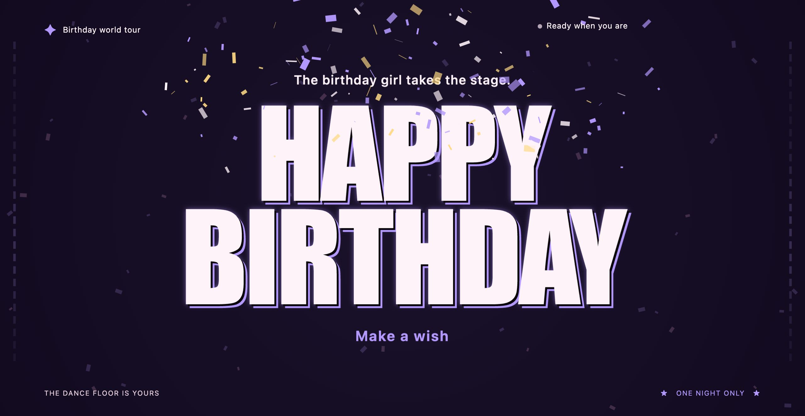
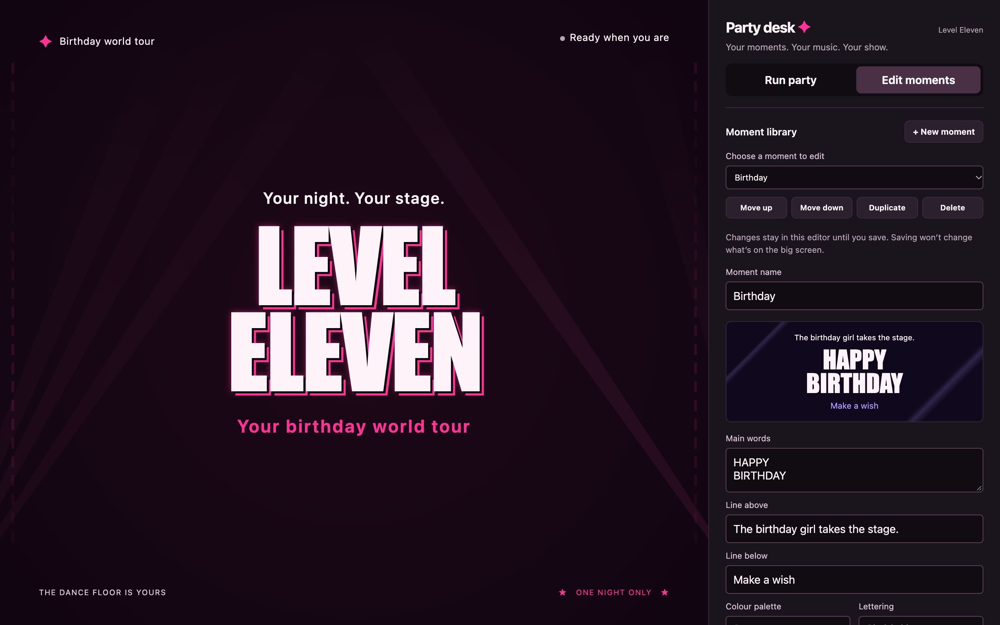

# Party Screen · Level Eleven

A local party projection with big typography, sound-reactive lights, editable scenes and a phone remote. Run it on a laptop, put the projection window on a projector, and control moments and effects over the same Wi-Fi.

No account, API key, subscription or package installation is required. Music is played separately in the player of your choice.

## Screenshots

**Birthday projection** — full-screen typography with a confetti celebration.



**Moment editor** — customise the words and look of a scene while the current projection stays on screen.



## What it does

- Six editable starting moments: Welcome, Dance floor, Hands in the air, Make some noise, Birthday and Countdown.
- Seven celebration effects: confetti, stars, light tunnel, laser fans, sparks, hearts and ribbons.
- Custom words, colours, lighting, lettering, intensity and timed returns for each moment.
- Laptop microphone input to drive the visuals, plus a simulated preview and gentle-motion setting.
- A separate projection window and a phone remote with a six-digit pairing code.
- Local browser storage and JSON export/import for the moment library.

## Start

You need Python 3 and a modern desktop browser. Development and testing have been on macOS with Python 3.12; other operating systems have not been verified. Node.js is only needed to run the JavaScript tests.

On macOS, double-click **Start Party Screen.command**, or run this from the project folder:

```sh
python3 server.py
```

The server prints its address and opens Party desk in your default browser. Normally this is http://127.0.0.1:8765/. If that port is occupied, use the alternative address printed by the server.

An optional port and browser-opening flag are supported:

```sh
python3 server.py 8766 --no-open
```

Keep the server running during the party. Press Control+C in its terminal to stop it.

## Try the show

1. Select a moment and use **Try preview** to see the lights without microphone access.
2. Play music through your speaker. Select **Listen to speakers** on the laptop and allow microphone access.
3. Select **Open projection window**, move that window onto the projector using an extended display, then enter full screen.
4. Keep one Party desk admin window open on the laptop. The projection window must use the same browser and local address.
5. Use **Edit moments** to customise the show. Download a backup before clearing browser data or changing the server address.

The microphone follows sound levels; it does not identify tracks, lyrics, choruses or beats precisely. Conversation and cheers can move the lights too.

## Control it from a phone

1. Connect the phone and laptop to the same trusted Wi-Fi network.
2. In Party desk, find **Phone control** and open the displayed address on the phone.
3. Enter the six-digit code shown on the laptop.
4. Launch moments, fire effects, clear effects or return from a timed moment.

The laptop must remain awake with Party desk open. The pairing code changes when the server restarts. Guest networks that isolate devices can prevent pairing; a local firewall can also block incoming connections. On macOS, allow local network access if prompted.

Editing moments and enabling the microphone happen on the laptop. A physical phone and projector still need to be tested in your own room; previous checks used browser clients and local network requests.

## Privacy and security

Audio is analysed in the laptop browser; the app does not record it, upload it or play it back. The app has no analytics, external fonts, third-party scripts or cloud service calls. Saved moments remain in browser storage unless you export a backup. Current scene information is shared with paired remote clients.

The server listens on all network interfaces so phones can connect. It uses plain HTTP and is intended for a trusted local network only. **Do not expose it through port forwarding, a public tunnel or public internet hosting.** Publishing the source does not require running the server publicly.

See [SECURITY.md](SECURITY.md) for the security boundaries. Only app files are served; repository documentation and Python source are excluded from the server's static-file allowlist.

## Limitations

- Spotify and other music players remain independent; there is no music-service integration.
- Synthetic speech, games and using a phone as a live microphone are not included.
- Saved scenes belong to the browser and address where they were created. Export/import transfers them.
- This is a local prototype, not a hardened multi-user hosted service.

More detailed controls are described in [READ ME.txt](READ%20ME.txt).

## Development and checks

The frontend uses plain HTML, CSS and JavaScript. The server uses only the Python standard library. No build step is needed.

```sh
node --test tests/moments.test.cjs
python3 tests/server_test.py
```

The tests cover scene transitions, countdown interruption, backup validation, pairing, command delivery and expiry, duplicate commands, admin conflicts and restricted endpoints. Server tests bind temporary loopback ports.

## Licence

[MIT](LICENSE). Copyright (c) 2026 Party Screen contributors.
